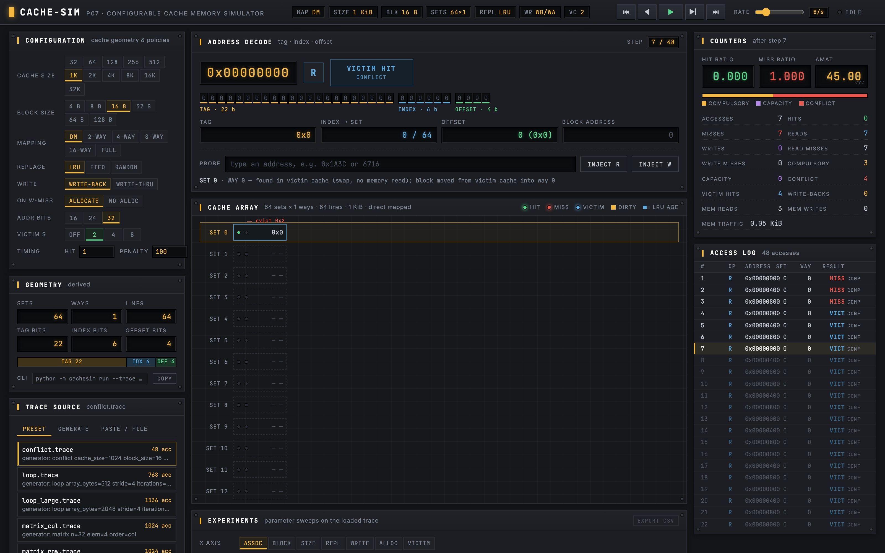

# CACHE-SIM — Configurable Cache Memory Simulator (P07)

**Computer Architecture & Organization — Lab Semester Project, Fall 2024**
NUST Balochistan Campus · Department of Computer Science · BSCS

| | |
|---|---|
| **Group** | 04 |
| **Members** | Aliyan Zulfiqar (leader), Shehroz Riaz |
| **Project** | P07 — Configurable Cache Memory Simulator |
| **Course topics** | Cache memory design (L13–14) |

A trace-driven cache simulator with a step-by-step web GUI styled like a bench instrument.
It supports direct-mapped, N-way set-associative and fully-associative mapping, any
power-of-two cache and block size, LRU / FIFO / Random replacement, write-back and
write-through with write-allocate or no-write-allocate, 3C miss classification
(compulsory / capacity / conflict), a trace generator, parameter sweeps with charts, and a
victim-cache extension. **Python standard library only — nothing to install.**



---

## 1. Quick start

Requirements: Python 3.8 or newer (tested on 3.9 and 3.14). No third-party packages.

```bash
git clone <repo-url> coa-lab-group4
cd coa-lab-group4

# full scripted demo: tests → traces → hand-worked example → sweeps → figures → GUI
scripts/run_demo.sh

# or just the GUI
PYTHONPATH=src python3 -m cachesim serve        # opens http://127.0.0.1:8077
```

On Windows (PowerShell):

```powershell
$env:PYTHONPATH="src"; python -m cachesim serve
```

## 2. Repository layout

```
coa-lab-group4/
├── README.md
├── LICENSE                      MIT
├── src/
│   ├── cachesim/                the simulator package (stdlib only)
│   │   ├── core.py              CacheConfig, decode(), Cache, 3C classifier, victim cache
│   │   ├── traces.py            trace parser (R/W, Dinero, Valgrind lackey) + generators
│   │   ├── experiments.py       parameter sweeps, CSV / text tables
│   │   ├── charts.py            dependency-free SVG bar / line charts
│   │   ├── cli.py               run · decode · gen · sweep · serve
│   │   └── server.py            stdlib HTTP server + JSON API for the GUI
│   └── web/                     index.html · style.css · app.js  (the GUI)
├── tests/                       39 unit tests checked against hand-worked examples
├── docs/                        design.md · hand_worked_examples.md · report.md · slides.md · demo_script.md
├── results/                     figures (SVG), CSV tables and summary.md from scripts/experiments.py
├── scripts/                     run_demo.sh · generate_traces.sh · experiments.py
└── data/                        trace files (sequential, loop, random, strided, matrix, conflict, textbook)
```

## 3. Using the GUI

```bash
PYTHONPATH=src python3 -m cachesim serve            # default port 8077
PYTHONPATH=src python3 -m cachesim serve --port 9000 --no-browser
```

| Panel | What it does |
|---|---|
| **CONFIGURATION** | Cache size, block size, mapping (DM / 2–16-way / full), replacement, write policy, allocation policy, address width, victim cache, timing for AMAT. Every change re-runs the trace instantly. |
| **GEOMETRY** | Derived sets / ways / lines and the tag-index-offset bit split, plus the equivalent CLI command. |
| **TRACE SOURCE** | Load a preset from `data/`, generate a synthetic trace (sequential, loop, random, strided, matrix, conflict) or paste / open a file. |
| **ADDRESS DECODE** | The current access shown bit by bit (tag / index / offset), its result and what the cache did. The **PROBE** field decodes any address you type; **INJECT R / W** appends it to the trace. |
| **CACHE ARRAY** | Every set and way with valid / dirty LEDs, tag and LRU age bars. Hits flash green, misses red, victim-cache hits blue. Caches with more than 64 sets switch to an activity map plus a detail window. |
| **COUNTERS** | Hit / miss ratio, AMAT, miss breakdown (compulsory / capacity / conflict), memory reads / writes, write-backs, traffic — all at the current step. |
| **ACCESS LOG** | One row per access; click a row to jump to that step. |
| **EXPERIMENTS** | Sweep associativity, block size, cache size, replacement, write policy, allocation or victim entries, optionally with a second parameter as series. Charts + table + CSV export. **COMPARE TRACES** runs the current configuration over every preset. |

Transport: `⏮ ◀ ▶ ▶▏ ⏭` or keyboard **Space** (play/pause), **← →** (step), **Home / End**.

## 4. Using the command line

```bash
export PYTHONPATH=src

# simulate a trace and print statistics (add --steps for every access)
python3 -m cachesim run --trace data/loop.trace --size 1024 --block 16 --assoc 4 --repl LRU --write WB
python3 -m cachesim run --trace data/textbook_dm.trace --size 32 --block 4 --assoc 1 --steps

# generate a trace instead of reading one
python3 -m cachesim run --gen loop array_bytes=512 iterations=3 --size 256

# address breakdown
python3 -m cachesim decode 0x1A3C --size 1024 --block 16 --assoc 4

# write a trace file
python3 -m cachesim gen random count=500 range_bytes=8192 write_ratio=0.3 -o data/my.trace

# parameter sweeps (table, CSV and SVG chart)
python3 -m cachesim sweep --trace data/conflict.trace --param associativity --values 1,2,4,8,0 \
        --series replacement --series-values LRU,FIFO,RANDOM --csv results/x.csv --svg results/x.svg --print

# regenerate every figure in results/
python3 scripts/experiments.py
```

`python3 -m cachesim --help` and `python3 -m cachesim <command> --help` list all options.

### Trace file format

```
# comment
R 0x00001A3C        read  (hex with 0x, or decimal without)
W 0x00001A40        write
0 1A3C              Dinero style: 0 = read, 1 = write (hex)
L 04010000,4        Valgrind lackey: L load, S store, M modify, I instruction (ignored)
```

Real program traces: `valgrind --tool=lackey --trace-mem=yes ./program 2> prog.trace`, then open the
file in the GUI (PASTE / FILE tab) or pass it to `--trace`.

## 5. Tests

```bash
python3 -m unittest discover -s tests -v
```

Every expected value in `tests/` was first worked by hand — see
[docs/hand_worked_examples.md](docs/hand_worked_examples.md). The suite covers geometry
and address decoding, the Hennessy & Patterson direct-mapped example, LRU vs FIFO vs
Random, the 3C classifier, write-back / write-through / no-write-allocate traffic
accounting, the victim cache, trace parsing, generators, sweeps, charts and the HTTP API.

## 6. Documentation

* [docs/design.md](docs/design.md) — architecture, block diagram, algorithms, 3C method, policy state machines
* [docs/hand_worked_examples.md](docs/hand_worked_examples.md) — the worked examples the tests verify
* [docs/report.md](docs/report.md) — technical report draft (sections per the course template)
* [docs/slides.md](docs/slides.md) — presentation outline (18 slides) with speaker notes
* [docs/demo_script.md](docs/demo_script.md) — 5–8 minute demo video script
* [results/summary.md](results/summary.md) — every experiment table with the command that produced it

## 7. Evaluation metrics implemented

Hit ratio, miss ratio, read / write miss ratios, misses by type (compulsory, capacity,
conflict — Hill's 3C model with a shadow fully-associative LRU cache), memory reads /
writes / write-backs, memory traffic in bytes, victim-cache hits, and AMAT
(`hit_time + memory_miss_ratio × miss_penalty + victim_hit_ratio × victim_penalty`).

## 8. License

MIT — see [LICENSE](LICENSE).

## Building the report and slides

`docs/report.md` and `docs/slides.md` are the sources; the PDF and PPTX are generated:

```bash
uv run --with python-pptx scripts/build_docs.py all   # GUI screenshots, figures, docs/report.pdf, docs/slides.pptx
```

This needs Google Chrome (rasterising and PDF printing), Node 22+ and python-pptx; the
simulator itself still needs nothing but Python. `scripts/chrome_tools.js` drives Chrome,
`scripts/paginate.js` lays the report out in IEEE two-column style.
